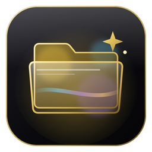

<p align="center"></p>

<h1 align="center">IBRA GLASS</h1>
<p align="center">زجاج لمستكشف ملفات ويندوز — Blur · Acrylic · Mica<br>ويندوز 10 و 11</p>

---

## شنو يسوي

يحوّل خلفية **مستكشف الملفات** إلى زجاج شفاف، ويطلعه بشكل فخم ويمشي ويا خلفية سطح المكتب.

- **42 ستايل جاهز** بـ 7 أقسام: فخم، داكن، فاتح، ملوّن، طبيعة، نيون، شفاف صافي.
- **معاينة مباشرة**: نافذة مستكشف وهمية فوق خلفيات مختلفة، وتكدر تحط خلفيتك الخاصة من جهازك. وتكدر تبدّل بين المعاينة الفاتحة والداكنة.
- **محرّر ستايل**: تختار نوع التأثير (Blur / Acrylic / Mica / Mica Alt / Blur Clear)، ولون وكثافة خاصة لكل وضع (فاتح/داكن)، وفيه ألوان سريعة وخيارات الشفافية.
- **ستايلاتي**: تحفظ الستايلات اللي تسويها، وتصدّرها وتستوردها (`.ibraglass`). تكدر تستورد حتى ملف `config.ini` جاهز.
- **المفضلة**، و**البحث**، وزر **عشوائي**.
- **تنصيب وإزالة بضغطة**. يعيد تشغيل المستكشف ويرجّع نفس المجلدات اللي كانت مفتوحة.
- **فحص التوافق**: يعرف نسخة ويندوز ويكلك أي تأثير يشتغل على جهازك.
- يكشف إذا كان المحرك مثبّت يدوياً بمكان ثاني ويوقفه حتى ما يصير تعارض.
- واجهة **عربي / English** تبدّلها من داخل البرنامج.

## التنصيب

1. من **Releases** نزّل `IBRA-GLASS-Setup-x.x.x.exe` وشغّله.
2. افتح IBRA GLASS، اختار ستايل، واضغط **ثبّت وطبّق**.
3. المستكشف يعيد تشغيل نفسه لثواني ويطلع بالشكل الجديد.

> **وضع الأمان:** إذا صار أي خلل، اضغط **ESC** مطوّل وانت تفتح المستكشف حتى يشتغل بدون التأثير، وبعدها من IBRA GLASS اضغط **إزالة**.
> حذف البرنامج من "إضافة/إزالة البرامج" يشيل التأثير تلقائياً.

## البناء

البناء يصير تلقائياً على GitHub Actions (ويندوز):

- كل `push` على `main` يبني المنصّب ويحطه بـ **Actions → Artifacts**.
- كل تاك يبدأ بـ `v` (مثلاً `v1.0.1`) ينشر **Release** والمنصّب مرفق بيه.

محلياً على ويندوز:

```powershell
npm ci
npm run engine      # ينزّل محرك ExplorerBlurMica الرسمي لمجلد engine/
npm start           # تشغيل للتجربة (شغّل الطرفية كمسؤول)
npm run dist        # يطلع المنصّب بمجلد dist/
```

## هيكل المشروع

```
src/main.js            المنطق: تنصيب/إزالة المحرك، config.ini، إعادة تشغيل المستكشف
src/ini.js             قراءة وكتابة config.ini
src/preload.js         الجسر بين الواجهة والنظام
src/renderer/          الواجهة (index.html, style.css, app.js, themes.js)
build/                 الأيقونة + سكربت المنصّب (installer.nsh)
scripts/fetch-engine.ps1   تنزيل المحرك الرسمي وقت البناء
```

## الحقوق

**تصميم وتطوير إبراهيم الخزرجي** · Telegram: [t.me/ibraprogram](https://t.me/ibraprogram) · TikTok: [@ibraprogram](https://www.tiktok.com/@ibraprogram)

### المحرك

التأثير الزجاجي داخل المستكشف ينفّذه محرك **[ExplorerBlurMica](https://github.com/Maplespe/ExplorerBlurMica)** من تطوير **Maplespe**، ومرخّص بـ **LGPL-3.0**.
IBRA GLASS لوحة تحكم ومنصّب حوالين هذا المحرك. المحرك يجي بنسخته الرسمية بدون أي تعديل، ووياه ملفات رخصته (`ENGINE-LICENSE.txt` و`ENGINE-COPYING.LESSER.txt`) واسم صاحبه، والبرنامج يذكر هالشي بصفحة "حول". تفاصيل أكثر بملف [NOTICE.md](NOTICE.md).
